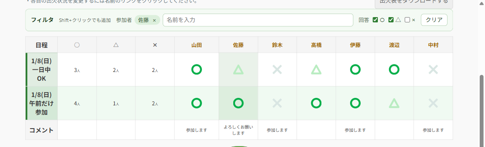

# 調整さん用 フィルタ（非公式）

調整さん（chouseisan.com）の回答ページで、参加者ごとに○・△の日を絞り込むChrome拡張です。

本拡張は調整さん運営元とは関係ありません。非公式・無保証です。

## 画面



## できること

- 参加者を選ぶと、その人の回答セルに色を付けます。
- 条件に合わない日程は非表示になります。
- 複数人を選ぶと、全員が条件を満たす日だけを残します。
- ○・△・×のチェックで、対象の回答を切り替えます。初期状態は○と△がオンです。
- 表の参加者名をShift+クリックしても、その人を追加・解除できます。
- クリアで選択と表示を戻します。

## インストール

1. このリポジトリをcloneするか、Code → Download ZIPでダウンロードします。

   ```sh
   git clone https://github.com/nAgI314/chouseisan-person-filter.git
   ```

2. Chromeで `chrome://extensions` を開きます。
3. 右上の「デベロッパー モード」をオンにします。
4. 「パッケージ化されていない拡張機能を読み込む」を押します。
5. 展開したフォルダ（`manifest.json` が入っているフォルダ）を選びます。

## 使い方

1. 調整さんの回答ページ（`https://chouseisan.com/s?h=...`）を開きます。
2. 表の上に出る「フィルタ」で、参加者名を入力して候補から選びます。
3. 必要に応じて○・△・×を切り替えます。
4. 表の参加者名をShift+クリックしても追加できます。通常クリックはサイトの編集操作です。
5. 「クリア」で選択と表示を戻します。

## 動作の決まり

- 複数人を選ぶとANDになります。全員の回答がチェックした記号に合う日だけを残します。
- 条件に合わない日程の行は非表示になります。表のコメント行はそのまま残ります。
- 全員が○の日を見るときは、△のチェックを外してください。
- 選択した人のセルは、その人の回答がチェックした記号に合うときに色を付けます。
- 表の「行と列の入れ替え」には対応していません。入れ替え中は案内を出し、絞り込みを止めます。
- 回答ページの通常表示（行＝日程、列＝参加者）だけを対象にします。

## 制限

- 本拡張は非公式・無保証です。調整さん運営元とは関係ありません。
- 調整さんのページ構造が変わると、動かなくなることがあります。
- PCのChromeだけで動作を確認しています。
- 外部への通信と設定の保存はしません。ページ内の表示だけを変えます。

## 開発

```sh
npm install
npm test
```

テストは `test/fixture.html` の表を読み、参加者・日程・記号の解析を確認します。

## ファイル

- `manifest.json`: 拡張の設定
- `content.js`: 表の解析、フィルタの表示、絞り込み
- `content.css`: 表の絞り込み表示
- `icons/`: アイコン
- `test/`: 解析のテスト
- `docs/`: スクリーンショット
- `LICENSE`: MITライセンス

## ライセンス

MIT。詳細は [LICENSE](LICENSE) を参照してください。
